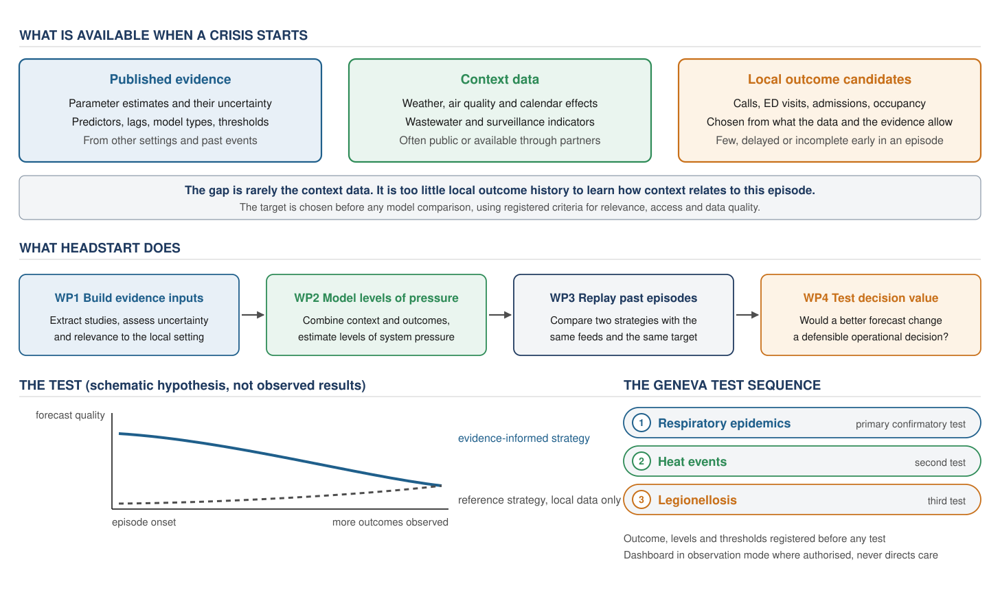

## 2.3 Detailed research plan

### 2.3.1 Objectives and hypotheses

The central hypothesis is that published evidence can improve forecasts early in an episode by helping estimate how the available context relates to the outcome, provided extraction uncertainty and relevance to the local setting are assessed.

|     | Role               | Statement                                                                                                  |
|-----|--------------------|------------------------------------------------------------------------------------------------------------|
| H1  | Evidence quality   | Do automated methods preserve the uncertainty in published numbers?                                        |
| C2  | Model adequacy     | Can the model reliably detect and assign probabilities to different levels of pressure?                    |
| H3a | Main hypothesis    | Does adding published evidence improve early forecasts when outcome data from the current episode are few? |
| H3b | Safety check       | Can adaptive weighting reduce harm when published evidence conflicts with local outcomes?                  |
| H3c | Secondary question | Do short-term changes in variability add useful predictive information?                                    |
| H4  | Decision value     | Does any gain in forecast quality change an operational decision for the better?                           |

*Figure 1. What is available when a crisis starts, the gap, what HEADSTART does (WP1 to WP4), the test, and the Geneva test sequence.*

#### O1. Make published evidence usable while acknowledging its uncertainties

> H1. When numbers are extracted from studies automatically, part of the uncertainty that the studies report is lost, both the uncertainty inside each study and the differences between studies. The distributions of plausible parameter values then come out too narrow. Adding a correction for extraction error should widen them back to a realistic size. To test this, a sample of studies is extracted manually and used as the reference. The automated results, with and without the correction, are compared with this reference. The correction is validated if it brings the spread ratio of T1.3 close to one and improves interval coverage at the pre-specified levels on the held-out studies. Studies used to tune the correction are kept out of this test set.

Automated extraction also misses numbers entirely [Shankar 2026]. H1 tests whether these omissions narrow the distributions further and whether the correction restores a useful level of uncertainty. The benchmark is built on parameter values. The other kinds of evidence (variables, model forms, thresholds) are compared with published reviews instead.

#### O2. Represent escalation in a form that separates the state from the point forecast

> C2. Model adequacy criterion. The model must give levels of pressure that make sense to the services and probabilities that are right on average, at the same false-alarm rate for every model. This common scale lets all candidate models be compared in operational terms. It does not assume that the regime-switching model beats simpler threshold methods.

Simulated data first test whether the levels and the moves between them can be recovered from the available data. Forecast calibration is the second check. If the model fails either check, the simpler ordinal model registered as fallback is used and the main comparison still goes ahead.

#### O3. Test whether published evidence improves forecasts and identify instances where it is detrimental

> H3a. In the first days of an episode, a strategy that uses published studies (for parameter values, explanatory variables, lags and model forms) will forecast better than a reference strategy that uses the same context data, local history and outcomes seen so far, but no model inputs derived from the published evidence in WP1. How long it lasts is secondary.
>
> H3b. Adaptive weighting lowers the weight of the published evidence when local outcomes contradict it. When the evidence is right, adaptive weighting should do no worse than fixed weighting, within a margin Δ. When the evidence is deliberately shifted in location, scale or relevance to the local setting, adaptive weighting should do better. This checks that the model limits harm instead of trusting the literature blindly. Δ is half of the smallest improvement counted as meaningful under H3a, so adaptive weighting may give up at most half of that benefit when the evidence is right.
>
> H3c. Two simple signals, the recent variability of demand and how strongly each day resembles the day before, are tested as extra predictors. The question is whether they add anything to the context data, the local level and trend, and the published evidence.
>
> Primary comparison. Both strategies choose their models with the same procedure and are scored with the continuous ranked probability score (CRPS), which rewards forecasts that put high probability near what actually happened. The main test uses respiratory episodes in their first days. The heat test is always run, but it counts as confirmatory only if the respiratory test passes, which keeps the overall false-positive rate under control. A secondary analysis follows how the difference evolves as local outcomes come in.

#### O4. Establish whether predictive improvement matters for decision-making

> H4. The forecast with the best score is not always the most useful one for the services. The models are therefore also judged on the decisions they would trigger, using the costs of acting too early, too late or for nothing, as stated by emergency-service experts. An evidence-informed forecast counts as useful only if it changes a decision that matters in practice.

#### Scope. Three Geneva crisis types

HEADSTART covers three Geneva crisis types. (1) Respiratory epidemics (SARS-CoV-2, influenza and RSV, together or one of them) are the main test because the published evidence is comparatively rich. (2) Heat events are the second test, with ozone and PM10 as co-exposures or effect modifiers rather than separate domains [Schulte 2024; Ragettli 2019]. (3) Legionellosis is the third test, in year four, on the linked case-environment data, and forecasts case incidence rather than demand. No fourth domain is planned. The three crisis types are fixed. Within each, the outcome measure, the population and, for respiratory epidemics, the pathogen are not fixed in this plan. They depend on what the published evidence defines and on the local service data available, for example emergency calls filtered on the recorded symptoms, emergency-department visits, hospital admissions, bed or ICU occupancy, or case counts. The candidates are listed at registration. The target is then chosen after an audit of access, completeness, cause coding, reporting delay, time resolution and usefulness for the services, before any forecast performance is compared, and it does not change afterwards. Open public series support the validation of the methods but are not presented as a substitute for local service data. At month 12 a data check confirms that the chosen target meets the registered criteria, otherwise the next candidate takes its place. The project is not intended to outperform established forecasting hubs when long outcome histories are available. It does not assume that published evidence will improve forecasts in every setting, and it does not promise clinical decision-making by an automated system. The dashboard, where authorised, will operate in observation mode only.
