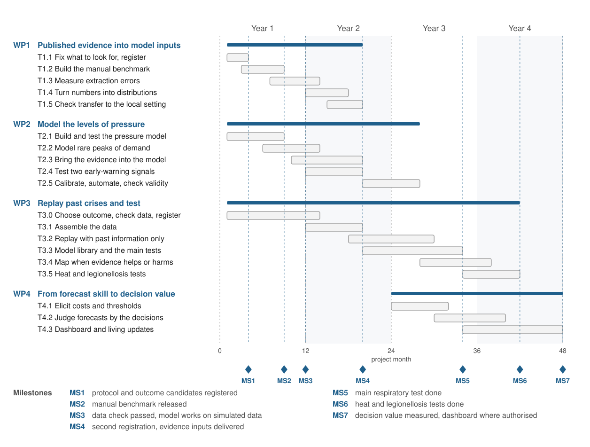

## 2.4 Schedule and milestones

I lead all four work packages. Research assistants (master's students) provide the second extraction arm from months 3 to 9 and support data handling and the evaluation pipeline. The work packages run in parallel with fallbacks. WP2 can use weakly informative distributions if extraction error proves too large, and the retrospective decision analysis of WP4 does not depend on live deployment. Open Swiss data are the fallback if no local series can be obtained, so access agreements remain a priority before the award.

*Figure 2. Work packages, task durations and milestones across the 48-month project.*

| Milestone | Month | Criterion |
|---|---|---|
| MS1 | 4 | Extraction protocol and outcome candidates registered (first registration) |
| MS2 | 9 | Manual benchmark released |
| MS3 | 12 | Data gate passed, pressure model passes its checks (or fallbacks chosen) |
| MS4 | 20 | Second registration done, evidence inputs delivered |
| MS5 | 34 | Main respiratory test done |
| MS6 | 42 | Heat and legionellosis tests done |
| MS7 | 48 | Decision value measured, dashboard for the validated demand tests where authorised, all results reported |
