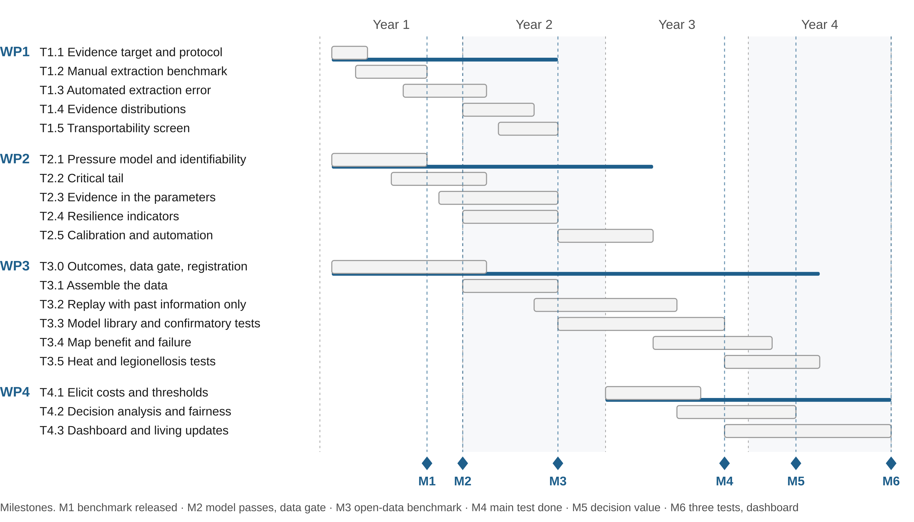

## 2.4 Schedule and milestones

I will lead WP2 and the confirmatory work in WP3, and lead WP1's protocol and WP4's decision analysis. A 50% scientific/technical collaborator for 48 months will support the extraction benchmark, data harmonisation, forecast-evaluation pipeline and reproducibility. A separately contracted independent extractor will provide the second extraction arm for T1.2 from months 3 to 9.

The work packages can proceed in parallel. WP2 can use weakly informative distributions if the extraction benchmark reveals unacceptable error, the open-data evaluation can proceed without clinical records, and WP4's retrospective decision analysis does not depend on live deployment. The open-data track cannot replace the operational demand test, so access agreements remain an important pre-award task.

*Figure 2. Work packages, task durations and milestones across the 48-month project.*

| Milestone | Month | Criterion                                                                                         |
|-----------|-------|---------------------------------------------------------------------------------------------------|
| M1        | 9     | Extraction benchmark released                                                                     |
| M2        | 12    | State model passes identifiability criteria, or fallback selected                                 |
| M3        | 20    | Open-data benchmark running, operational series harmonised (or fallback)                          |
| M4        | 34    | Primary early-episode hypothesis tested by the forecast comparison                                |
| M5        | 40    | Decision relevance established                                                                    |
| M6        | 48    | Analysis across crisis types complete; dashboard for validated demand-based settings where authorised |
